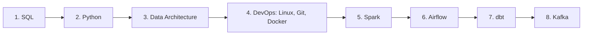
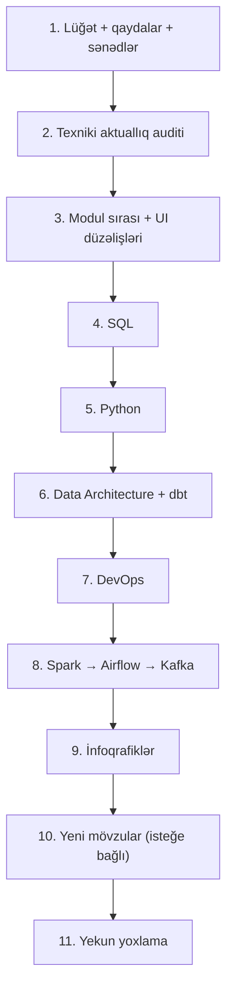

# 🎯 Data Engineering Platforması — Keyfiyyət Auditi və İcra Planı (v2)

> **Rol**: Keyfiyyət mütəxəssisi (QA) + Data Engineering kurrikulum rəyçisi
> **Hədəf**: Platformanı **Intern / Junior Data Engineer** vakansiyalarına hazırlıq üçün dəqiq, ardıcıl və peşəkar formaya salmaq.
> **İş qaydası**: Hər addımdan **əvvəl** nə ediləcəyi, **sonra** nə edildiyi bildirilir; növbəti addıma yalnız təsdiqdən sonra keçilir.

---

## 📝 v2-də nə dəyişdi? (v1-ə rəy)

v1 planı yaxşı başlanğıc idi, lakin kodla yoxlama zamanı bir neçə səhv və boşluq aşkarlandı:

| # | v1-dəki iddia / boşluq | Yoxlamanın nəticəsi | v2-də qərar |
|---|---|---|---|
| 1 | Python/SQL YAML-larında `infographic` (ASCII) və `output_description` doldurulmalıdır | `LessonView.tsx` bu sahələri **ümumiyyətlə oxumur** — yalnız `registry.tsx`-dəki React sxemləri göstərilir. ASCII renderer artıq silinib | Doldurulmayacaq. Əvəzinə digər 66 YAML-dakı istifadəsiz ASCII `infographic` blokları **ölü data** kimi qeyd olunur (silinməsi isteğe bağlıdır) |
| 2 | "Logical Query Processing Order müsahibələrin 90%-də soruşulur" | Mənbəsiz rəqəm | Rəqəm çıxarıldı; mövzu "çox tez-tez soruşulur" kimi qalır |
| 3 | Planın öz mətnində "istehsalat", "modüllər" (türk dili) kimi səhvlər var idi | Planın özü qaydaya zidd idi | Düzəldildi |
| 4 | **Texniki aktuallıq yoxlanışı yox idi** | Bu gün 2026-cı ilin oktyabrıdır: Airflow 3 (2025) SubDAG, `execution_date` və köhnə SLA mexanizmini çıxarıb, Webserver → API Server olub; Kafka 4.0 (2025) ZooKeeper-i tam çıxarıb; Spark 4.0 buraxılıb. Dərslər (məs. `airflow:12` SLA, `kafka:02` ZooKeeper) bunu əks etdirməlidir | **Yeni Addım 2** əlavə edildi |
| 5 | **HomeHub-da yanlış/şişirdilmiş məlumatlar** nəzərə alınmamışdı | Track kartlarında dərslərdə olmayan mövzular var (Polars, AsyncIO, "GIL-siz paralel icra", Helm charts, "Airflow 2.9 LTS" — Airflow-da LTS yoxdur). "TAMAMLANDI / DAVAM EDİR" badge-ləri real progress-dən asılı deyil, sabit yazılıb | Addım 3-ə daxil edildi |
| 6 | **Hədəf auditoriya uyğunsuzluğu** | InterviewHub "FAANG", "Senior / Staff", "senior səviyyəli müsahibələr" yazır — hədəf isə intern/junior-dur | Addım 3-ə daxil edildi |
| 7 | **UI bug** nəzərə alınmamışdı | `InterviewHub.tsx` səviyyə rəngini `senior`/`middle` ilə yoxlayır, data isə `junior`/`intermediate`/`advanced` istifadə edir → bütün kartlar eyni yaşıl rəngdə görünür | Addım 3-ə daxil edildi |
| 8 | **Köhnəlmiş sənədlər** | `README.md` və `.agents/.rules/project-rules.md` hələ də layihəni **Streamlit** tətbiqi kimi təsvir edir (`st.tabs` və s.), real frontend isə Next.js-dir. `modules/*.py` və `app.py` köhnə Streamlit kodudur | Addım 1-ə daxil edildi |
| 9 | Testlər işləmir | `venv`-də `pytest` quraşdırılmayıb | Addım 11-də düzələcək |
| 10 | Dərs sırasının dəyişdirilməsinin riski qeyd olunmamışdı | Dərs `id`-ləri URL-lərdə, `localStorage` progress-də və `registry.tsx` açarlarında istifadə olunur | Yalnız `order` sahəsi dəyişəcək, `id`-lər **toxunulmaz** qalacaq |
| 11 | Addım 5–7 hər biri 24 dərs idi — bir təsdiq üçün çox böyük | Rəy vermək çətin olur | Hər modul ayrıca alt-addım oldu |
| 12 | Junior DE üçün çatışmayan mövzular analiz edilməmişdi | Bax: Bölmə 2-G | Ayrıca **isteğe bağlı** Addım 10 |

---

## 📌 1. Mövcud vəziyyət

- **8 modul, 87 dərs**: SQL (10), Python (11), Spark (12), Kafka (12), Airflow (12), DevOps (12), Data Architecture (12), dbt (6).
- **Data axını**: `data/content/<modul>/*.yaml` → `export_static.py` → `frontend/src/data/staticData.json` → Next.js 16 (React 19, Tailwind 4).
- **Sxemlər**: 87/87 dərs `frontend/src/components/viz/registry.tsx`-də React/SVG sxemi ilə təmin olunub (379 AZ/EN mətn cütü).
- **Build**: `npm run build` uğurla keçir (101 statik səhifə). `export_static.py` xətasız işləyir.
- **İnteraktiv məşğələ**: yalnız Python (11/11) və SQL (9/10). Digər modullarda yoxdur (bu, nəzəri modullar üçün normaldır).

---

## 🔍 2. Audit nəticələri

### A. Hərfi tərcümə nəticəsində mənası pozulan terminlər
Qayda: **tərcümədə mənası dəyişən və ya müsahibədə tanınmayan terminlər ingilis dilində qalır.** Lazım olduqda ilk istifadədə qısa AZ izahı mötərizədə verilir.

| Hazırkı ifadə | Say | Olmalıdır |
|---|---|---|
| boru kəməri | 17 fayl | **pipeline** / **data pipeline** |
| istehsalat | 45 fayl, ~80 dəfə | **production** / **prod mühiti** |
| qar dənəciyi sxemi | 6 | **Snowflake schema** |
| ulduz sxemi | 15 | **Star schema** |
| yavaş dəyişən ölçülər | 3 | **Slowly Changing Dimensions (SCD)** |
| tənbəl hesablama | 5 | **lazy evaluation** |
| məlumat əyriliyi | 12 | **data skew** |
| çatdırılma semantikası | 3 | **delivery semantics** |
| dinamik task xəritələnməsi | 4 | **Dynamic Task Mapping** |
| pəncərə funksiyaları | 9 | **window functions** |
| səbət | 2 | **bucket / bucketing** |
| icraçılar / işçilər | — | **Executor / Worker** |
| axın şini (HomeHub) | 1 | **streaming platform** / **event bus** |
| imic, imiclər | — | **image** (Docker image) |
| laylar | — | **layer**-lər |
| müdafiəli kəmərlər | 1 | **defensive pipelines** |

> [!NOTE]
> Hər "istehsalat" avtomatik əvəz edilməyəcək — kontekstə baxılaraq "production", "prod mühiti" və ya "real layihə" seçiləcək.

### B. Qrammatika və orfoqrafiya
1. **kilit-** → **kilid-** (kilidləmək, kilidləyir) — 11 fayl, 20 dəfə.
2. **Defis + şəkilçi ahəngi**: `Spark-ın`, `Kafka-nın`, `Airflow-un`, `dbt-nin`, `Docker-in`, `DAG-ın`, `API-dən` — tutarlı qayda tətbiq ediləcək (son hecanın tələffüzünə görə).
3. **Kalka cümlələr**: ingiliscədən söz-söz tərcümə edilmiş, təbii səslənməyən cümlələr sadələşdiriləcək.
4. **Şişirdilmiş ifadələr**: "möhtəşəm", "nəhəng", "super", çoxlu nida işarələri — tədris mətnində neytral, dəqiq tona gətiriləcək.
5. **Mənbəsiz rəqəmlər**: "216x sürətli", "100 dəfə sürətli" kimi uydurma benchmark-lar ya "təxmini/nümunə" kimi işarələnəcək, ya da yumşaldılacaq (`project-rules.md`: *"If unsure, mark it clearly"*).

### C. Kurrikulum ardıcıllığı
**Modul sırası** hazırda iki yerdə fərqlidir:
- `export_static.py` / Sidebar: Python → SQL → Spark → Kafka → Airflow → DevOps → Data Architecture → dbt
- `HomeHub.tsx` Track-ləri: SQL → Python → Data Architecture → Kafka → Spark → Airflow → dbt → DevOps

**Təklif olunan vahid sıra (junior üçün):**

Əsaslandırma:
- SQL junior müsahibələrinin əsas texniki filtridir, ona görə birinci gəlir.
- Data Architecture (OLTP/OLAP, Star schema, SCD, Medallion) Spark və dbt-nin **niyə** istifadə olunduğunu izah edir.
- Linux/Git/Docker sonrakı bütün alətlərin işlədiyi mühitdir.
- **Kafka sona keçir** (v1-dən fərqli olaraq): streaming junior vakansiyalarında batch-dən (Spark/Airflow/dbt) daha az tələb olunur və konseptual olaraq ən çətin moduldur.

> [!IMPORTANT]
> Bu sıra bir təklifdir. Addım 3-dən əvvəl sizin təsdiqiniz alınacaq.

**Modul daxili sıra problemləri** (yalnız `order` dəyişəcək, `id`-lər qalacaq):
- **SQL**: `05-aggregations-group-by` (junior) `04-joins` (intermediate)-dan sonradır; `09-ctes` `08-window-functions`-dan sonradır. Təklif: SELECT → ORDER BY → GROUP BY → CASE/COALESCE → String/Date → Keys/Normalization → JOIN → CTE → Window Functions → Set Operations.
- **Data Architecture**: `11-etl-vs-elt` (junior) sonda qalıb, `03-evolution` mövzusundan dərhal sonra gəlməlidir.
- **dbt**: `06-docs-seeds-and-project-structure` (junior) sonda — layihə strukturu əvvəldə olmalıdır.
- Hər modulda `level` (junior → intermediate → advanced) sırası ilə `order` uyğunlaşdırılacaq.

### D. Müsahibəyə hazırlıq
1. **21 dərsdə `interviewer_tips` yoxdur** (bütün Python və SQL). Bu dərslərdə "Müsahibəçi ipucu" bloku görünmür.
2. **Səviyyə uyğunsuzluğu**: InterviewHub "Senior / Staff", "FAANG" yazır → "Intern / Junior → Middle" olmalıdır; ipucu başlığı "SENIOR MÜSAHİBƏÇİ İPUCU" → "MÜSAHİBƏ İPUCU".
3. Cavablarda müsahibədə səsləndirilməli açar ingilis terminləri **bold** ilə vurğulanacaq.
4. SQL-də **logical query processing order** və tez-tez rast gəlinən tapşırıqlar (duplicate silmək, top-N per group, running total, gaps & islands) ayrıca vurğulanacaq.

### E. İnfoqrafiklər (`registry.tsx` + `viz/*.tsx`)
1. **Terminologiya**: 22+ AZ mətndə A bölməsindəki problemli terminlər var ("Boru Kəməri", "İstehsalat Qaydası", "Məlumat Əyriliyi", "Ulduz Sxemi" və s.).
2. **Təkrarlanan sxemlər**: `kafka:03` və `kafka:05` eyni `PartitionLogViz`-dən istifadə edir; `spark:08` və `sql:08` eyni `WindowFunctionViz`-dən. `kafka:05` (producer key → partition) üçün ayrıca sxem lazımdır.
3. **Vizual peşəkarlıq**: başlıq uzunluğu, mobil görünüş, işıqlı/qaranlıq rejimdə kontrast, ox etiketlərinin oxunaqlığı brauzerdə yoxlanılacaq.
4. **Texniki dəqiqlik**: sxemlərdəki faktlar (məs. Airflow komponent adları, Kafka ZooKeeper) Addım 2-nin nəticələrinə uyğunlaşdırılacaq.

### F. UI mətnləri və sənədlər
- `HomeHub.tsx`: dərslərdə olmayan mövzular (Polars, AsyncIO, GIL-siz icra, Helm, "Airflow 2.9 LTS", "PostgreSQL 16 Engine", "4 Architecture RFCs") və sabit "TAMAMLANDI / DAVAM EDİR" badge-ləri.
- `InterviewHub.tsx`: səviyyə rəngi bug-ı + auditoriya mətnləri.
- `data/i18n.yaml`: hazırda istifadə olunub-olunmadığı yoxlanılacaq (Streamlit dövründən qala bilər).
- `README.md`, `project-rules.md`: Next.js arxitekturasını əks etdirmir.

### G. Junior DE üçün çatışmayan mövzular (isteğe bağlı genişlənmə)
Junior vakansiyalarda tez-tez tələb olunan, lakin ayrıca dərsi olmayan mövzular:
- **pandas əsasları** (read_csv, groupby, merge, null-ların idarəsi) — hazırda yalnız dağınıq istinadlar var.
- **API-dən data çəkmək** (requests, pagination, retry, rate limit).
- **Cloud əsasları** (S3/GCS object storage, IAM anlayışı) — konseptual səviyyədə.
- **Batch vs Streaming** və **CDC** — ayrıca icmal dərsi.
- **SQL indexlər və `EXPLAIN`** əsasları.
- **Portfolio layihəsi**: bütün modulları birləşdirən uçdan-uca mini layihə təsviri (API → Python → Postgres/Parquet → dbt → Airflow).

> [!NOTE]
> Bu bölmə yeni məzmun yaradılması deməkdir və `project-rules.md`-dəki "extra modul yaratma" qaydasına təsir edir. Ona görə ayrıca addım kimi saxlanılıb və yalnız sizin qərarınızla icra olunacaq.

---

## 🗺️ 3. Addım-addım icra planı

| Addım | Məzmun | Toxunulan fayllar |
|---|---|---|
| **1** | `glossary_az.yaml`-ı 3 kateqoriyalı lüğətə çevirmək: (a) ingiliscə qalan terminlər, (b) AZ qarşılığı olanlar, (c) qadağan olunmuş hərfi tərcümələr. `project-rules.md` və `README.md`-ni Next.js arxitekturasına uyğunlaşdırmaq. `i18n.yaml`-ın istifadəsini yoxlamaq | `data/glossary_az.yaml`, `.agents/.rules/project-rules.md`, `README.md` |
| **2** | **Texniki aktuallıq auditi** (yalnız hesabat, dəyişiklik yox): Airflow 3, Kafka 4.0, Spark 4.0, dbt-nin cari versiyası üzrə köhnəlmiş iddiaları rəsmi sənədlərlə yoxlamaq. Mənbəsiz benchmark rəqəmlərinin siyahısı | hesabat → bu fayla əlavə |
| **3** | Vahid modul sırası (`export_static.py`, `HomeHub.tsx`); modul daxili `order` düzəlişləri; HomeHub track mətnlərinin real məzmuna uyğunlaşdırılması; InterviewHub səviyyə bug-ı və auditoriya mətnləri | `export_static.py`, `HomeHub.tsx`, `InterviewHub.tsx`, `LessonView.tsx`, YAML `order` sahələri |
| **4** | **SQL** (10 dərs): terminlər, qrammatika, `interviewer_tips` (10), `03-keys-normalization` üçün məşğələ | `data/content/sql/*` |
| **5** | **Python** (11 dərs): terminlər, qrammatika, `interviewer_tips` (11) | `data/content/python/*` |
| **6** | **Data Architecture** (12) + **dbt** (6) | müvafiq YAML-lar |
| **7** | **DevOps** (12) | müvafiq YAML-lar |
| **8a / 8b / 8c** | **Spark** (12) → **Airflow** (12) → **Kafka** (12) — hər biri ayrıca təsdiqlə; Addım 2-nin aktuallıq düzəlişləri burada tətbiq olunur | müvafiq YAML-lar |
| **9** | İnfoqrafiklər: terminologiya, `kafka:05` üçün ayrıca sxem, brauzerdə mobil/tema yoxlaması | `viz/registry.tsx`, `viz/*.tsx` |
| **10** | *(İsteğe bağlı)* Bölmə 2-G-dən seçdiyiniz yeni dərslər | yeni YAML + sxem |
| **11** | `export_static.py`, `npm run build`, `pytest` quraşdırıb testləri işə salmaq, brauzerdə seçmə yoxlama, yekun hesabat | — |

### Hər modul addımında (4–8) eyni yoxlama siyahısı
- [ ] A bölməsindəki terminlər lüğətə uyğundur
- [ ] Orfoqrafiya və şəkilçi ahəngi düzgündür
- [ ] AZ mətn EN mətnlə məna baxımından uyğundur (əlavə/çatışmayan iddia yoxdur)
- [ ] Texniki iddialar aktualdır (Addım 2)
- [ ] `interviewer_tips` mövcuddur və junior səviyyəsinə uyğundur
- [ ] `level` və `order` məntiqlidir
- [ ] `export_static.py` xətasız işləyir

---

## 🧪 4. Addım 2 Nəticəsi: Texniki Aktuallıq və Benchmark Auditi Hesabatı

Bütün 87 dərs üzrə rəsmi sənədlərlə aparılmış texniki aktuallıq yoxlamasının nəticələri (müvafiq modul addımlarında düzəldiləcək):

### 4.1. Alət və Versiya Aktuallığı Tapıntıları

| Modul / Dərs | Hazırkı İddia / Kod | Rəsmi Fakt (2025–2026) | Ediləcək Düzəliş (Addım 6–8-də) |
|---|---|---|---|
| `airflow/01`, `03`, `04` | Kod nümunələrində `schedule_interval='@daily'` işlədilir | Airflow 2.4-dən etibarən `schedule_interval` köhnəlib (deprecated) və `schedule=` ilə əvəzlənib; Airflow 3.0-da tam silinib (`airflow/06`, `07`, `12` artıq `schedule=` istifadə edir — modul daxilində uyğunsuzluq var) | `01`, `03`, `04`-də əsas parametr kimi `schedule='@daily'` yazmaq və mötərizədə köhnə kodlarda `schedule_interval` rast gəlindiyini qeyd etmək |
| `airflow/02-architecture-components` | Yalnız `Webserver` adı çəkilir | Airflow 2.x-də UI komponenti **Webserver**, Airflow 3.0+-da isə **API Server** (FastAPI əsaslı) adlanır; həmçinin DAG fayllarının oxunması ayrı **DAG Processor** komponentinə ayrılıb | `Webserver (Airflow 3-də API Server)` kimi qeyd əlavə etmək ki, namizəd hər iki versiya ilə bağlı suala hazır olsun |
| `airflow/06-scheduling-data-interval` | `execution_date`-in Airflow 2.2-də `logical_date` ilə əvəzləndiyi yazılıb | Doğrudur; əlavə olaraq Airflow 3.0-da `execution_date` tamamilə silinib | Qısa qeyd kimi Airflow 3.0-da tam silindiyini əlavə etmək |
| `airflow/11-dynamic-task-mapping-groups` | SubDAG-ların deprecated olduğu yazılıb | Airflow 3.0-da `SubDagOperator` tamamilə silinib (removed) | "köhnəlib və Airflow 3.0-da tamamilə silinib" kimi dəqiqləşdirmək |
| `airflow/12-monitoring-sla-antipatterns` | `default_args`-da `"sla": timedelta(hours=1)` və `sla_miss_callback` göstərilir | Köhnə `sla` mexanizmi mürəkkəb və qeyri-dəqiq olduğu üçün Airflow 3.0-da çıxarılıb və **Deadline Alerts** ilə əvəzlənib; lakin Airflow 2.x klasterlərində və müsahibələrdə hələ də soruşulur | `on_failure_callback` və `execution_timeout`-u əsas mexanizm kimi saxlamaq, `sla` / `sla_miss_callback` üçün isə *"Airflow 2.x-də SLA, Airflow 3.0+-da Deadline Alerts"* qeydini əlavə etmək |
| `kafka/02-architecture-cluster-kraft` | Daxili metadata topic-in adı `@metadata` kimi yazılıb (sətir 59, 70, 156); sətir 154-də `distributed distributed` təkrarı var | Kafka KRaft-da daxili metadata topic-in rəsmi adı **`__cluster_metadata`**-dır (`registry.tsx` sətir 451-də düzgün yazılıb, YAML-da səhvdir). Həmçinin **Kafka 4.0 (2025)** versiyasında ZooKeeper dəstəyi tamamilə silinib | `@metadata` → `__cluster_metadata` düzəltmək; Kafka 4.0-da ZooKeeper-in tam silindiyini vurğulamaq; təkrar sözü silmək |
| `spark/06-partitions-coalesce` & `spark/04-narrow-wide-shuffle` | Default `200` shuffle partition-dan danışarkən AQE qeyd olunmur (`spark/10`-da AQE var) | Spark 3.2+-dan bəri **Adaptive Query Execution (AQE)** default olaraq aktivdir (`spark.sql.adaptive.enabled=true`) və kiçik post-shuffle partition-ları avtomatik birləşdirir | Müsahibədə namizədin fərqlənməsi üçün: *"Default 200-dür, lakin Spark 3.2+ AQE aktiv olduqda kiçik partition-ları icra zamanı avtomatik coalesce edir"* qeydini əlavə etmək |
| `devops/09-docker-compose-stack` | `docker-compose.yml` kodunda `version: "3.8"` sətri var | Docker Compose v2-də `version:` atributu köhnəlib (obsolete) və terminalda xəbərdarlıq verir | `version: "3.8"` sətrini silmək (və ya şərhdə köhnəldiyini qeyd etmək) |
| `dbt/04-testing-and-data-quality` | `schema.yml`-də yalnız `tests:` açarı göstərilir | dbt 1.8+-dan etibarən Unit Test-lərdən fərqləndirmək üçün `tests:` açarı `data_tests:` olaraq yenilənib (hər ikisi işləyir) | Kodda və ya izahda dbt 1.8+ standartı olan `data_tests:` açarını da qeyd etmək |

### 4.2. Mənbəsiz / Şişirdilmiş Rəqəmlər Siyahısı (İllüstrativ Qeyd Əlavə Ediləcək)

| Fayl | Hazırkı İfadə | Düzəliş |
|---|---|---|
| `data_architecture/01-oltp-vs-olap-columnar.yaml` | "Niyə Sütunlu Baza Analitikada 100 Dəfə Sürətlidir?", "216x FASTER with 96% LESS DISK I/O!" | Başlığı "Niyə Sütunlu Saxlanc Analitik Sorğularda Qat-qat Sürətlidir?" etmək; kod çıxışındakı rəqəmlərin **nümunəvi hesablamaya (illustrative benchmark)** aid olduğunu qeyd etmək |
| `data_architecture/11-etl-vs-elt-evolution.yaml` | "50 dəfə sürətli" | "dəfələrlə sürətli (klaster gücündən asılı olaraq)" kimi neytrallaşdırmaq |
| `spark/09-caching-memory-oom.yaml` | "20x faster" | "nümunə ssenaridə ~20x sürətlənmə" kimi dəqiqləşdirmək |
| `spark/11-file-formats-parquet.yaml` | "10x smaller / 10 dəfə kiçik" | "adətən 4x–10x daha kiçik (datanın təkrarlanmasından asılı olaraq)" kimi dəqiqləşdirmək |
| `sql/10-set-operations.yaml` | "`UNION ALL` is 10x faster" | "`UNION ALL` sort və deduplikasiya etmədiyi üçün əhəmiyyətli dərəcədə sürətlidir" kimi yazmaq |

---

## ✅ İcra statusu

| Addım | Status |
|---|---|
| Audit və plan (v2) | ✅ Tamamlandı |
| **Addım 1**: Lüğət (`glossary_az.yaml`), `i18n.yaml`, `project-rules.md`, `README.md` | ✅ Tamamlandı |
| **Addım 2**: Texniki aktuallıq auditi | ✅ Tamamlandı |
| **Addım 3**: Modul sırası + UI düzəlişləri (`export_static.py`, `HomeHub.tsx`, `InterviewHub.tsx`, `LessonView.tsx`) | ✅ Tamamlandı |
| **Addım 4**: SQL Modulunun Tam Təkmilləşdirilməsi (10 Dərs + `interviewer_tips` + `03-keys-normalization` məşğələsi) | ✅ Tamamlandı |
| **Addım 5**: Python Modulunun Tam Təkmilləşdirilməsi (11 Dərs + `interviewer_tips`) | ✅ Tamamlandı |
| **Addım 6**: Data Architecture (12 Dərs) + dbt (6 Dərs) Modullarının Təkmilləşdirilməsi | ✅ Tamamlandı |
| **Addım 7**: DevOps Modulunun Təkmilləşdirilməsi (12 Dərs) | ✅ Tamamlandı |
| **Addım 8a**: Spark Modulunun Təkmilləşdirilməsi (12 Dərs) | ✅ Tamamlandı |
| **Addım 8b**: Airflow Modulunun Təkmilləşdirilməsi (12 Dərs) | ✅ Tamamlandı |
| **Addım 8c**: Kafka Modulunun Təkmilləşdirilməsi (12 Dərs) | ✅ Tamamlandı |
| **Addım 9**: İnfoqrafiklərin Peşəkarlaşdırılması (`registry.tsx`, `MedallionViz.tsx`, `WindowFunctionViz.tsx`, yeni `ProducerPartitionerViz.tsx`) | ✅ Tamamlandı |
| **Addım 10**: Yeni Dərslərin Əlavə Edilməsi (SQL: `11-indexes-b-tree-explain`, `12-three-valued-logic-null`; Python: `12-rest-api-ingestion-retry`, `13-pandas-basics-dataframes`; Data Architecture: `13-batch-vs-streaming-cdc`) — Cəmi 92 dərs | ✅ Tamamlandı |
| **Addım 11**: Yekun Doğrulama və Bütöv Test Dəsti | ⏳ Təsdiq gözləyir |
