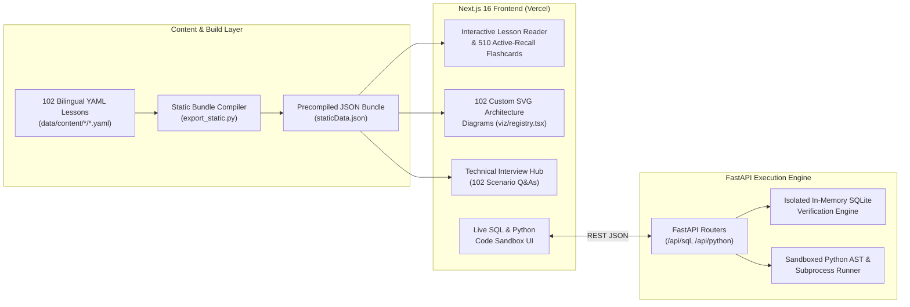

# DataEng.AZ — Interactive Data Engineering Learning & Sandbox Platform

[](https://project-c037y.vercel.app)
[](https://nextjs.org/)
[](https://fastapi.tiangolo.com/)
[](https://www.sqlite.org/)

A full-stack, bilingual (**EN / AZ**) interactive documentation, architecture visualization, and live code-execution platform engineered to teach **Big Data, Distributed Systems, and Modern Data Engineering**.

- **Live Deployment:** [https://project-c037y.vercel.app](https://project-c037y.vercel.app)

---

## System Architecture



---

## Key Capabilities & Curriculum (10 Modules · 102 Lessons)

| # | Module | Lessons | Key Engineering Topics Covered |
| :- | :--- | :---: | :--- |
| 1 | **SQL & Analytical Querying** | 12 | Joins, Window Functions (`ROW_NUMBER`, `LAG/LEAD`), CTEs, Indexing, Query Optimization + **Live SQL Sandbox** |
| 2 | **MS SQL Server & T-SQL** | 5 | T-SQL procedural logic, Stored Procedures, UDFs, temp tables, transaction isolation |
| 3 | **Python for Data Engineering** | 13 | Data structures, generators, OOP, memory efficiency, Pandas/PySpark foundations + **Live Python Sandbox** |
| 4 | **Data Architecture & DWH** | 13 | OLTP vs OLAP, Kimball Star Schema, SCD Types 1/2/3, Medallion Architecture (`Bronze -> Silver -> Gold`), Data Quality Gates |
| 5 | **Modern Open Lakehouse** | 5 | Apache Iceberg table format, Project Nessie (Git-for-Data / Write-Audit-Publish), Trino distributed SQL engine |
| 6 | **Apache Spark (PySpark)** | 12 | Driver/Executor architecture, Lazy Evaluation, DAGs, Shuffle mechanics, Broadcast Joins, Partitioning & Bucketing |
| 7 | **Apache Kafka** | 12 | KRaft consensus, Broker/Partition internals, Producer `acks`, Consumer Groups, Offset management, Schema Registry |
| 8 | **Apache Airflow** | 12 | DAG scheduling, Operators, TaskFlow API, XComs & Claim-Check pattern, Sensors, Idempotency & Backfilling |
| 9 | **dbt (Data Build Tool)** | 6 | `ref()` lineage, Materializations (`view`, `table`, `incremental`), Jinja macros, Schema & Data Quality tests |
| 10 | **DevOps, Linux & Containers** | 12 | Linux CLI/permissions, Networking, Docker multi-stage builds, Docker Compose multi-container orchestration, Git workflows |

---

## Repository Structure

```text
├── data/
│   ├── content/          # 102 bilingual YAML lesson definitions across 10 modules
│   ├── glossary_az.yaml  # Standardized Azerbaijani technical terminology
│   └── i18n.yaml         # UI localization strings (EN / AZ)
├── export_static.py      # Compiles YAML curriculum into frontend/src/data/staticData.json
├── frontend/             # Next.js 16 (React 19, TypeScript, Tailwind CSS v4) web application
│   └── src/
│       ├── app/          # Next.js App Router dynamic lesson & hub routes
│       ├── components/   # Lesson Reader, Code Sandboxes, Interview Hub, 102 SVG Diagrams
│       └── data/         # Precompiled staticData.json bundle for 0ms client navigation
├── server/               # FastAPI backend for live SQL & Python code execution (/healthz, /api/*)
├── modules/              # SQLite in-memory sandbox verifier & isolated Python execution engine
└── tests/                # Automated test suite for YAML schema integrity, sandboxes, and API routes
```

---

## Local Development

### 1. Backend API & Static Bundle Compiler

```bash
python -m venv venv
# Windows:
venv\Scripts\activate
# Linux / macOS:
source venv/bin/activate

pip install -r requirements.txt

# Compile YAML curriculum into staticData.json:
python export_static.py

# Launch FastAPI sandbox server on port 8000:
uvicorn server.main:app --reload --host 127.0.0.1 --port 8000
```

### 2. Next.js Frontend

```bash
cd frontend
npm install
npm run dev
```

Open `http://localhost:3000` in your browser.

---

## Running Tests

Validate YAML curriculum schemas, SQL/Python execution engines, and FastAPI endpoints:

```bash
python -m unittest discover -s tests -p "test_*.py"
```
